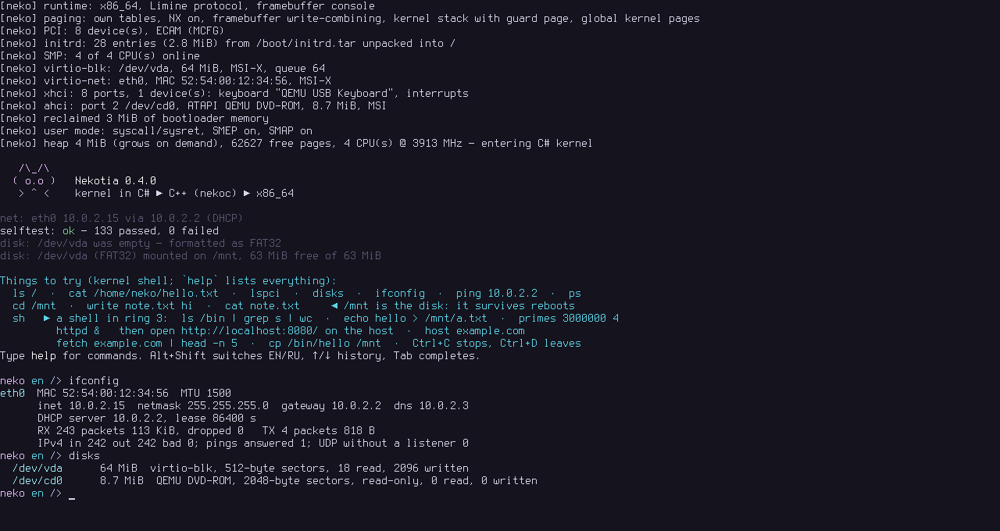
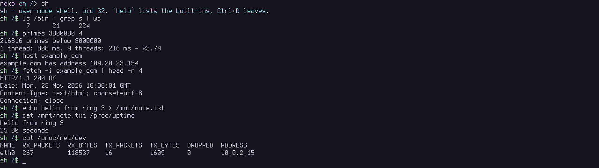
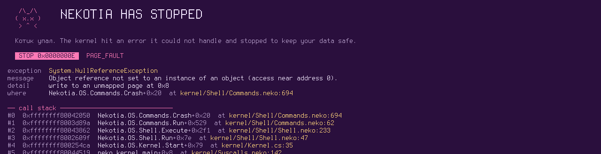

<div align="center">

```
   /\_/\
  ( o.o )
   > ^ <
```

# Nekotia

**Операционная система для x86_64, у которой ядро и программы написаны на C#.**

[](https://github.com/Pawmii/Nekotia/actions/workflows/ci.yml)


[](LICENSE)



</div>

Nekotia — настоящее ядро: оно загружается в QEMU или на железе, само управляет памятью, прерываниями,
процессорами и устройствами. При этом почти всё, что выше аппаратного уровня — shell, драйвер клавиатуры, стек
TCP/IP, `/proc`, системные вызовы, утилиты, — написано на C#.

Внутри нет ни .NET, ни сборщика мусора. Собственный транслятор **nekoc** (Roslyn) переводит подмножество C# в
C++20, а clang собирает из него обычное freestanding-ядро. C# здесь — язык исходников, а не среда выполнения.

## Что уже умеет

- **Загрузка и железо** — BIOS и UEFI через Limine, до 16 процессоров (SMP), ACPI, APIC-таймер, PCI/PCIe, MSI и MSI-X.
- **Память** — свои таблицы страниц с NX и W^X, SMEP/SMAP, buddy-аллокатор, растущая куча ядра, стеки с guard-страницами.
- **Многозадачность** — вытесняющий планировщик с приоритетами, мьютексы и семафоры, обнаружение взаимных блокировок.
- **Программы** — процессы в ring 3 со своими адресными пространствами и потоками, загрузчик ELF, Ctrl+C и `kill`,
  futex, TLS, исключения `try/catch`; падение программы не роняет систему.
- **Файлы** — VFS, initrd, `/dev`, `/proc`, каналы (`a | b`), FAT32 с длинными именами на дисках virtio, SATA и NVMe.
- **Сеть** — virtio-net и стек TCP/IP на C#: DHCP, DNS, ping, UDP, TCP. Внутри есть веб-сервер, который открывается в
  браузере хоста, и `fetch`, который качает страницы из интернета.
- **USB** — контроллер xHCI, клавиатура и мышь.
- **Отладка** — экран смерти со стеком вызовов в терминах C# (методы, файлы, строки), отладка по строкам C# в gdb и
  VS Code, 190+ самотестов, которые CI прогоняет в QEMU на BIOS и UEFI.

<div align="center">

</div>

## Быстрый старт

Нужны .NET SDK 10, clang/lld/llvm, xorriso, QEMU и Limine. На Arch Linux всё ставит один скрипт:

```sh
git clone https://github.com/Pawmii/Nekotia.git && cd Nekotia
scripts/setup-arch.sh      # пакеты; на других системах: Limine — scripts/fetch-limine.sh
make doctor                # проверить, всё ли на месте
make run                   # собрать C# → C++ → ядро → ISO и запустить в QEMU
```

Откроется окно QEMU с командной строкой ядра. Кликните в него и попробуйте:

| | |
|---|---|
| `help`, `info`, `ps`, `lspci`, `lsusb`, `disks` | система и устройства |
| `ifconfig`, `ping 10.0.2.2`, `netstat` | сеть (QEMU раздаёт адрес по DHCP и выпускает в интернет) |
| `cd /mnt`, `write note.txt hi`, `cat note.txt` | `/mnt` — это диск `build/disk.img`, он переживает перезапуск |
| `sh` | shell в ring 3: `ls /bin \| grep s \| wc`, `primes 3000000 4`, `host example.com`, `fetch example.com \| head -n 5` |
| `httpd &` в `sh` | затем откройте **http://localhost:8080/** в браузере хоста |
| `neko` | котик |
| `crash null` | посмотреть на экран смерти |

Alt+Shift переключает раскладку EN/RU, ↑/↓ — история, Tab — дополнение, Ctrl+C — прервать программу.

## Как выглядит код

Программа для ring 3 — обычный C# с `Main`. Make сам находит каталоги в `user/` и кладёт программы в `/bin`:

```csharp
// user/visits/Visits.cs — пример: каталог user/visits с nekotia.json и этим файлом
using Nekotia;
using Nekotia.User;

public static unsafe class Program
{
    public static int Main(int argc, byte** argv)
    {
        Console.WriteLine($"Hello from ring 3! I am process {Process.Id()}, {Time.UptimeMs()} ms after boot.");

        long fd = File.Open("/mnt/visits.txt", File.Write | File.Create | File.Append);
        File.WriteBytes((int)fd, Str.Bytes("one more visit\n"), 15);
        File.Close((int)fd);
        return 0;
    }
}
```

Код ядра — тот же язык. Например, системный вызов, написанный на C#:

```csharp
// kernel/Net/Sockets.neko — `connect` для программ
@syscall(40)
static long TcpConnect(ulong ip, ulong port)
{
    int h = Tcp.Connect((uint)ip, (ushort)port, Process.CurrentPid());
    return h < 0 ? h : Install(KindTcp, h);   // сокет — обычный файловый дескриптор
}
```

Поддерживаются `struct`, `enum`, указатели и `unsafe`, свойства и операторы, generic-методы, function pointers,
паттерны и `switch`-выражения, `try/catch/finally`, интерполяция строк без аллокаций (`$"{size,8:size}"`).
Файлы `.neko` добавляют немного сахара: `defer`, `lock`, `asm { }`, `loop`, `for i in 0..n`. Подробности — в
[docs/LANGUAGE.md](docs/LANGUAGE.md).

## Как это устроено

```
 kernel/*.cs, *.neko         sdk/ (C# API ядра и программ)         user/*/ (программы)
          └───────────────────────────┬──────────────────────────────────┘
                                      ▼
        nekoc (tools/nekoc, Roslyn): .neko → C# → проверка подмножества → C++20 с #line на строки C#
                                      ▼
        clang++ -ffreestanding  +  runtime/ (C++: загрузка, память, прерывания, драйверы, VFS, FAT32)
                                      ▼
        ld.lld → nekotia.elf  +  initrd.tar (/bin, /etc)  →  Limine  →  nekotia.iso  →  QEMU / железо
```

Граница проходит так: всё, что работает с железом и памятью напрямую, написано на C++ в `runtime/` — загрузка,
таблицы страниц, планировщик, драйверы virtio/AHCI/NVMe/xHCI, VFS и FAT32. Логика поверх этого — на C# в `kernel/`:
shell, сетевой стек, `/proc`, драйвер клавиатуры, системные вызовы. Программы пользуются SDK `sdk/Nekotia.User`.
Подробное описание всех подсистем — [docs/ARCHITECTURE.md](docs/ARCHITECTURE.md).

## Отладка

<div align="center">

</div>

- **Экран смерти** показывает тип исключения в терминах .NET (`NullReferenceException`, `StackOverflowException`…),
  место в C#-файле, стек вызовов и регистры. Проверить все варианты: `crash null|div|throw|assert|pf|gp|ud|stack|nx|wp|deadlock`.
- **Расширение VS Code** (`make vscode-ext`) с language server `nekoc lsp`: автодополнение, подсказки, переход к
  определению — для `[Native]`-методов прямо в C++-рантайм, ссылки, переименование, ошибки nekoc на лету, и всё это
  в `.neko` тоже. Сервер стандартный (LSP по stdio), подключается и к Neovim, Helix, Zed.
- **F5 в VS Code** собирает отладочное ядро, запускает QEMU с gdb и останавливается на точках останова прямо в `.cs` и
  `.neko`. Без VS Code: `make debug` и `gdb build/debug/nekotia.elf -ex 'target remote :1234'`.
- **`make run-host`** запускает ядро как обычный Linux-процесс с ASan/UBSan — быстрый прогон самотестов.

## Команды сборки

| Команда | Что делает |
|---|---|
| `make run` / `make run-uefi` | собрать и запустить в QEMU (BIOS / UEFI) с диском, сетью и USB-клавиатурой |
| `make test` | самотесты в QEMU на BIOS и UEFI + проверка FAT32-образа (то же делает CI) |
| `make test-nekoc` | тесты транслятора |
| `make run-host` | ядро как Linux-процесс с санитайзерами |
| `make debug` | отладочная сборка, QEMU ждёт gdb на `:1234` |
| `make iso`, `make kernel`, `make user`, `make initrd` | отдельные этапы сборки |
| `make check` | только диагностика nekoc |
| `make vscode-ext` | расширение VS Code: language server, подсветка `.neko`, сниппеты, «показать C++ для метода» |
| `make test-lsp` | тесты language server и клиента VS Code |
| `make doctor`, `make clean` | проверить инструменты, удалить `build/` |

## Структура репозитория

| Каталог | Что там |
|---|---|
| `kernel/` | ядро на C#: shell, сетевой стек (`Net/`), `/proc`, драйвер клавиатуры, системные вызовы, самотесты |
| `user/` | программы для ring 3: `sh`, `ls`, `cat`, `grep`, `wc`, `httpd`, `fetch`, `nc`, `primes`… |
| `sdk/` | C# API: `Nekotia.Sdk` для ядра, `Nekotia.User` для программ |
| `runtime/` | C++: загрузка, память, планировщик, процессы, драйверы, VFS, FAT32, рантайм программ |
| `tools/nekoc/` | транслятор C# → C++ |
| `tests/nekoc/` | тесты транслятора |
| `editor/vscode-nekotia/` | расширение VS Code |
| `initrd/` | файлы, которые попадают в `/etc` и `/home` системы |
| `docs/` | [архитектура](docs/ARCHITECTURE.md), [язык](docs/LANGUAGE.md) |

## Статус

| Фаза | |
|---|---|
| 0–1. Фундамент и транслятор | ✅ загрузка, nekoc с диагностикой, сахар `.neko`, тесты транслятора, CI |
| 2. Прерывания, время, консоль | ✅ APIC, IRQ на C#, консоль с кириллицей, экран смерти, `try/catch` |
| 3. Виртуальная память | ✅ свои таблицы страниц, buddy, растущая куча, глобальные страницы |
| 4. Многозадачность | ✅ потоки, SMP, мьютексы и семафоры, обнаружение deadlock |
| 5. Пользовательский режим | ✅ процессы, ELF, системные вызовы на C#, SMEP/SMAP, futex, TLS |
| 6. Драйверы и файловые системы | ✅ PCI, virtio, AHCI, NVMe, xHCI, VFS, FAT32, `/proc`, каналы, TCP/IP |
| 7. Инструменты разработчика | 🚧 language server ✅; дальше — отладка в один клик, шаблоны, документация SDK |
| 8. Графика | ⏳ композитор окон, шрифты, GUI-программы |

Подробный план и то, что осталось в каждой фазе, — в [ROADMAP.md](ROADMAP.md).

## Лицензия

Nekotia распространяется под [Nekotia Noncommercial License](LICENSE). Коротко:

- ✅ можно использовать, изучать, изменять и распространять — и исходники, и собранные образы;
- ✅ кто получил от вас сборку, вправе запросить у вас её исходный код, и вы обязаны его предоставить;
- ❌ нельзя использовать в коммерческих целях без отдельного разрешения автора;
- ❌ нельзя выдавать весь проект за свой: сохраняйте указание автора и отмечайте, что версия изменена.

Это некоммерческая лицензия с открытым исходным кодом (source-available): по определению OSI «open source» не
должен ограничивать коммерческое использование. Шрифт Terminus (SIL OFL 1.1), заголовок `limine.h` (0BSD) и
загрузчик Limine (BSD-2-Clause) остаются под своими лицензиями.
