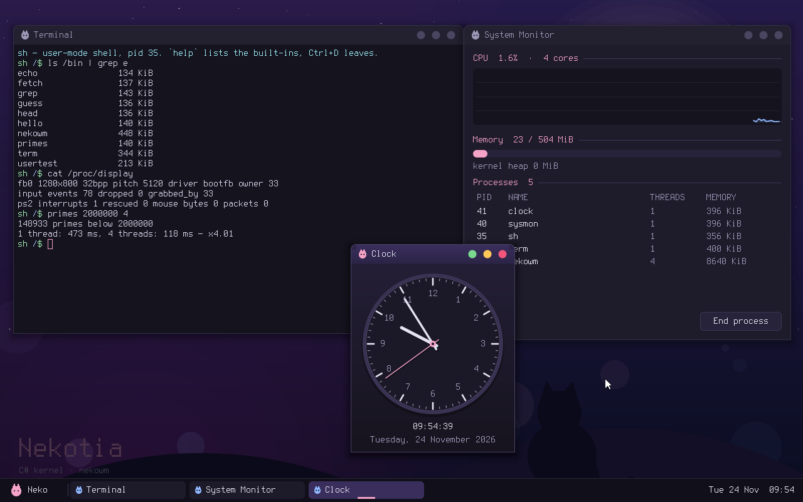

# Графика Nekotia: база для своих DE/WM и первый рабочий стол

<div align="center">

</div>

Графика в Nekotia — не часть ядра. Ядро даёт четыре примитива: **дисплей**, **ввод**, **общую память** и
**каналы сообщений**. Поверх них в userspace работает *сервер дисплея*: оконный менеджер и композитор в одной
программе. Приложения общаются с ним по **оконному протоколу**. Любая программа, которая слушает имя `display`
и говорит на этом протоколе, — рабочий стол. Первый такой рабочий стол — `nekowm`. Тайловый WM, киоск или
что-то совсем своё можно написать на том же SDK, не меняя ни ядро, ни приложения.

```
 приложения (term, sysmon, clock, paint, about …)          ← App / Window / Canvas / Font / Theme
        │  оконный протокол: сообщения по каналу «display»,
        │  пиксели окна — в общей памяти, которую создаёт приложение
        ▼
 сервер дисплея = WM + композитор (nekowm)                 ← WindowServer / Screen / InputDevice / Damage / Cursor
        │  /dev/fb0 (mmap + ioctl)       /dev/input (события)
        ▼
 ядро: neko::display ← драйвер (bootfb сейчас; virtio-gpu, nvidia … потом)
       neko::input   ← клавиатуры PS/2 и USB, мыши PS/2 и USB, virtio-tablet
       shm, каналы, poll, mmap, ioctl
```

Рендер сейчас полностью программный (CPU). Сервер собирает кадр в своём буфере в RAM, копирует изменённые
прямоугольники в скрытый буфер видеопамяти и переключает страницы (page flip) раз в vblank. Для GPU в этой схеме
меняется только нижний слой (см. «Драйвер GPU»).

### Кадры: двойной буфер и vsync

- **Двойной буфер.** Драйвер `bochs` (стандартный VGA в QEMU, `drivers/bochs.cpp`) забирает дисплей 0 у `bootfb`.
  Он делает виртуальную высоту экрана вдвое больше видимой, а переключение буфера сводит к записи одного регистра
  (`Y_OFFSET`). `Screen.PresentFrame` копирует в скрытый буфер изменения этого кадра и предыдущего (скрытый буфер
  отстаёт на кадр), потом делает `ioctl(FLIP)`. На экране никогда нет недорисованного кадра. Если драйвер не умеет
  переключать буферы (`bootfb`), кадр копируется прямо на экран.
- **vsync.** `ioctl(VBLANK)` сообщает время следующего vblank. Драйвер может знать его из железа, иначе ядро
  отсчитывает 60 Гц по таймеру. `nekowm` накапливает ввод и изменения и собирает не больше одного кадра за vblank,
  как бы быстро ни двигалась мышь. Если перед этим долго ничего не происходило, кадр собирается сразу, без ожидания.
- **Скорость.** `nekowm -v` раз в 2 секунды печатает (в консоль и serial) fps, пиксели за кадр и время каждой фазы.
  Перетаскивание окна 716×460 (≈400 тыс. пикселей за кадр):

  | | было | стало |
  |---|---|---|
  | QEMU без KVM (TCG) | ≈ 60 мс на кадр, из них 52 мс на копирование в видеопамять | ≈ 4.5 мс |
  | QEMU с KVM | < 1 мс | < 1 мс |

  Помогли три вещи. `memcpy`/`memset` копируют по 8 байт (`rep movsq`): под эмуляцией строковые команды
  выполняются поэлементно. В видеопамять кадр пишется 16-байтными non-temporal записями
  (`Memory.CopyStream`). У тени теперь таблица альфы по квадрату расстояния, без `sqrt` на пиксель.
  `make run` включает KVM, если есть `/dev/kvm`.

## Попробовать

```sh
make run            # в shell ядра или в sh: nekowm
make run-desktop    # сразу в рабочий стол (init=nekowm)
```

| | |
|---|---|
| кнопка **Neko** на панели или клавиша Super (Win) | меню запуска (`/etc/nekowm/apps`) |
| Ctrl+Alt+T | терминал |
| перетаскивание заголовка, двойной клик по нему | переместить, развернуть/восстановить |
| правый нижний угол окна | изменить размер (вживую: приложение перерисовывается на ходу) |
| кнопки в заголовке | свернуть, развернуть, закрыть |
| Alt+Tab, Alt+F4 | следующее окно, закрыть |
| кнопка окна на панели | показать/свернуть |
| меню → Exit desktop | вернуться в консоль |
| Ctrl+Alt+Backspace | аварийный выход: ядро завершает сервер дисплея, консоль возвращается |
| Ctrl+Alt+F12 | (отладка) состояние всех потоков — в serial |

В QEMU указатель приходит с `virtio-tablet` (абсолютные координаты, мышь не захватывается) или с PS/2/USB-мыши
(относительные). `make run` подключает планшет.

## Ядро

### Дисплеи — `neko::display`, `/dev/fbN`

`runtime/include/neko/display.hpp`, `runtime/src/core/display.cpp`. Драйвер описывает память развёртки
(физический адрес, pitch, формат) и регистрирует её через `display::add(Device)`. Появляется `/dev/fbN`:

| Операция | Что делает |
|---|---|
| `open(O_WRITE)` | сделать вызывающего *владельцем* (один на дисплей, остальным `kErrBusy`); для `fb0` консоль ядра встаёт на паузу: текст сохраняется, пиксели не трогаются |
| `close` / выход процесса | освободить; консоль перерисовывает весь экран |
| `mmap(fd, size, write)` | видеопамять в адресное пространство программы, write-combining |
| `ioctl(0x4401, Info*)` | размер, pitch, формат, флаги (`NeedsPresent`, `Accelerated`, `Primary`), имя драйвера, владелец |
| `ioctl(0x4402, Rect*)` | «этот прямоугольник изменился»: драйверы, у которых CPU рисует не в память развёртки (virtio-gpu, видеокарта со своей VRAM), копируют его на экран |
| `ioctl(0x4403, N)` | показать буфер N (`Info.buffers` > 1; буферы идут в отображении через `Info.buffer_offset` байт) |
| `ioctl(0x4404, Vblank*)` / `ioctl(0x4405)` | когда следующий vblank (номер, время, период, из железа или по таймеру) / дождаться его |
| `ioctl(≥ 0x4480, …)` | запросы самого драйвера: ускорение, режимы, буферы |
| `read` | сырые пиксели (`cat /dev/fb0 > shot.raw`) |

Экран смерти всегда снимает паузу с консоли, показывает буфер 0 (`display::emergency_reset`) и рисует поверх.
Когда владелец закрывает дисплей, тоже возвращается буфер 0: там живёт консоль.

### Ввод — `neko::input`, `/dev/input`

`runtime/include/neko/input.hpp`, `runtime/src/core/input.cpp`. Пока `/dev/input` никто не открыл, клавиши идут в
консоль как раньше. Открывший его (только один) *захватывает* ввод и читает события по 32 байта:

| Тип | Поля |
|---|---|
| `Key` (1) | `code` — скан-код set 1 (+0x100 после 0xE0), `pressed`, `codepoint` — символ по текущей раскладке EN/RU (стрелки и т.п. — коды консоли `0x110000…`), `mods` |
| `Motion` (2) | `x, y` — относительное смещение |
| `Button` (3) | `code` — 0 левая, 1 правая, 2 средняя, `pressed` |
| `Wheel` (4) | `y` — щелчки (положительные — вниз) |
| `Absolute` (5) | `x, y` — 0…32767 (планшеты) |

Источники: C#-драйвер клавиатуры (`kernel/Drivers/Keyboard.neko`, PS/2 и USB), C#-драйвер PS/2 мыши
(`kernel/Drivers/Mouse.neko`), USB-мыши (`xhci.cpp`), virtio-input (`virtio_input.cpp`). Состояние кнопок у каждого
устройства своё, поэтому два указателя не отменяют нажатия друг друга. Последовательные движения в очереди
склеиваются.

PS/2: у контроллера один выходной буфер на оба порта, а его линии прерываний на I/O APIC срабатывают по фронту.
Непрочитанный байт значит, что нового фронта не будет. Поэтому оба обработчика (IRQ 1 и 12) вычитывают буфер до
конца и раздают байты по биту «auxiliary», а сторожевой поток раз в 20 мс подбирает байт, о котором никто не сообщил.

### Общая память, каналы, poll, mmap, ioctl

`runtime/include/neko/ipc.hpp`, `runtime/src/core/ipc.cpp`, `vfs.cpp`, `process.cpp`.

| № | Вызов | |
|---|---|---|
| 36 | `poll(PollFd*, n, timeout_ms)` | готовность любых fd: каналы, слушатели, pipe, `/dev/input` (−1 — без таймаута) |
| 37 | `mmap(fd, length, flags)` | отобразить объект (общую память, `/dev/fbN`); `unmap(address)` снимает отображение целиком |
| 38 | `ioctl(fd, request, arg)` | запросы устройства |
| 39 | `shm_create(bytes)` | новая обнулённая общая память (целые страницы, ≤ 64 МиБ) |
| 64 | `ipc_listen(name)` | слушать имя (одно на имя; освобождается с закрытием) |
| 65 | `ipc_connect(name)` | новый канал к слушателю |
| 66 | `ipc_accept(fd)` | серверный конец следующего подключения |
| 67 | `ipc_send(fd, data, len, attach_fd)` | сообщение ≤ 4 КиБ, к нему можно приложить любой открытый файл; не блокируется (`kErrBusy`, если очередь получателя полна) |
| 68 | `ipc_recv(fd, buf, cap, int* fd_out)` | ждать сообщение; приложенный файл становится новым fd получателя |

Каналы и общая память — обычные файлы VFS (`vfs::open_object`): `dup`, наследование, закрытие при выходе и `poll`
работают для них сами собой. Страницы, отображённые из объекта, помечены в PTE битом `Shared`: процесс не освобождает
их при выходе (память принадлежит объекту и уходит с последним fd и последним отображением), а `mprotect`
отказывается менять их права. Поэтому окно, отображённое только для чтения, не станет записываемым.

## Оконный протокол

`sdk/Nekotia.Gui/Protocol.cs`. Каждое сообщение — структура `Message` фиксированного размера (тип, окно, x/y/w/h,
код, значение, символ, модификаторы, флаги, заголовок до 64 байт UTF-8).

| Направление | Сообщения |
|---|---|
| приложение → сервер | `Hello` · `CreateWindow` (+ общая память W×H×4) · `Attach` (новый буфер и размер) · `Damage` (прямоугольник) · `SetTitle` · `Destroy` · `Move` (просьба) |
| сервер → приложение | `Welcome` (размер экрана) · `Configure` (сервер хочет такой размер) · `Close` (пользователь закрыл) · `Focus` · `Key` · `Pointer` (Move/Button/Wheel/Enter/Leave, координаты окна) · `Frame` (последний `Damage` на экране) · `Release` (буфер освобождён) |

Пиксели окна живут в общей памяти, которую создаёт приложение. Сервер отображает её только для чтения. Буферов два
(`FlagDoubleBuffered`, `App` ставит его всегда). Приложение рисует в тот, что сервер не показывает, и отправляет
`Damage` с его номером. Сервер сразу переключается на него и отвечает `Release` для второго. `App.Present` ждёт
`Release`, переносит изменения кадра во второй буфер и отдаёт его под рисование. Поэтому сервер никогда не читает
буфер, в который рисуют, и внутри окна не бывает разрывов. Сервер отвечает `Frame` после того, как собрал кадр.

Изменение размера тоже делает приложение. Новая пара буферов уходит (`Attach`) вместе с первым кадром нового
размера, так что пустой буфер на экран не попадает. При перетаскивании угла `nekowm` держит не больше одного
`Configure` без ответа: следующий уходит, когда приложение ответило или молчит дольше 250 мс. Быстрое приложение
следует за курсором, медленное не заваливается запросами.

Сервер никогда не ждёт клиента: если очередь клиента переполнена, сообщение теряется, и зависшее приложение мешает
только себе. Единственное исключение — `Release`: его клиент ждёт, поэтому сервер повторяет отправку в каждом
цикле, пока сообщение не влезет в очередь.

## SDK `sdk/Nekotia.Gui`

Подключается к программе строкой `"../../sdk/Nekotia.Gui"` в `sources` её `nekotia.json`.

| Файл | Что там |
|---|---|
| `Canvas.cs` | программный растеризатор над любым буфером: заливки (в том числе полупрозрачные), рамки, градиенты, скруглённые прямоугольники со сглаживанием, мягкие тени, линии Брезенхема и сглаженные толстые линии, круги и кольца, треугольники, блиты (непрозрачные и с альфой), 1-битные маски с масштабом; всё с клипом |
| `Font.cs` | PSF1/PSF2 с Unicode-таблицей (Terminus 8×16 из `/usr/share/fonts`, кириллица), UTF-8, измерение, обрезка с «…», центрирование, масштаб |
| `Color.cs`, `Geometry.cs` | `Blend/Mix/Shade`; `Rect`, `Point`, `Damage` — набор изменённых прямоугольников со слиянием |
| `Theme.cs` | общий вид: цвета, кнопка, поле, полоса, заголовок раздела |
| `App.cs` | клиент: `Connect`, `CreateWindow`, `Present`/`Damage`, `Resize`, `SetTitle`, `Destroy`, `Next(out Message, timeout)` |
| `WindowServer.cs` | серверная половина протокола для любого рабочего стола: слушает, принимает, отображает буферы, превращает сообщения в `ServerEvent` и отправляет ввод и команды |
| `Devices.cs` | `Screen` (`/dev/fbN`: владение, mmap, буфер в RAM, `Present`), `InputDevice` (`/dev/input`), коды клавиш |
| `Cursor.cs` | программные курсоры (стрелка, изменение размера, перемещение) |

### Приложение

```csharp
App.Connect();
App.CreateWindow("Hello", 320, 120, 0, out Window w);
Canvas* c = &w.Canvas;                       // пиксели окна — общая память с сервером
c->Clear(Theme.Window);
App.SystemFont->Draw(c, 16, 50, "Привет из ring 3", Theme.Text);
App.Present(ref w);
while (App.Next(out Message m, -1) > 0 && m.Type != Protocol.Close) { }
App.Destroy(ref w);
```

Своё ожидание вместе с другими fd (как в `term`, который ждёт и сервер, и вывод `sh`): положить `App.Fd` в
`Poll.Wait` и забирать сообщения через `App.Next(out m, 0)`.

### Свой рабочий стол

Сервер — это цикл вокруг `WindowServer`. Политику (где окна, как выглядят, кто в фокусе) решает он сам:

```csharp
Screen.Open(0, out Screen screen);           // /dev/fb0: консоль на паузе
InputDevice.Open(out InputDevice input);     // клавиатура и мышь — наши
WindowServer.Start(screen.Width, screen.Height);
loop {
    fds[0] = input.Fd;                       // свои fd первыми
    int n = WindowServer.FillPoll(fds, 1);   // + слушатель и клиенты
    Poll.Wait(fds, n, timeout);
    // ввод: решить, чьё это событие → WindowServer.SendKey / SendPointer
    WindowServer.Dispatch(fds, n);
    while (WindowServer.NextEvent(out ServerEvent e)) {
        // WindowNew → разместить, WindowGone → убрать и Release, Damage → запомнить прямоугольник …
    }
    // собрать изменённые прямоугольники в screen.Back (окна — ServerWindow.Pixels), screen.Present(r)
    WindowServer.SendFrames();
}
```

`nekowm` (`user/nekowm`, около 1200 строк) так и устроен:

- `Desktop.cs` — ввод, фокус, стек окон, перетаскивание, изменение размера, разворачивание, меню, запуск программ
  (каждую ждёт свой поток, чтобы не оставались зомби).
- `Render.cs` — композитор. Каждый изменённый прямоугольник перерисовывается снизу вверх: обои (отрисованы один раз
  при старте), тени и рамки окон, содержимое окон, контур изменения размера, полупрозрачная панель, меню, курсор.
  Полупрозрачность получается сама собой благодаря порядку снизу вверх.

## Драйвер GPU (nvidia и другие)

Новый драйвер встаёт в `neko::display`, а всё, что выше, остаётся как есть:

1. **Вывод на экран.** Драйвер находит карту (`pci`), настраивает режим и отдаёт `display::add` описание памяти,
   которую видит CPU (`phys`, `pitch`, `width`, `height`, `format`). `mmap` `/dev/fbN` отображает именно её.
2. **Двойной буфер**: `Device.buffers = 2` и `Driver::flip(index)`; vblank из железа — `Driver::vblank`. Пример —
   `drivers/bochs.cpp`, около 100 строк.
3. **Если CPU рисует не в память развёртки** (свой буфер в VRAM с копированием DMA, двойная буферизация,
   virtio-gpu), драйвер ставит флаг `NeedsPresent` и реализует `Driver::present(x, y, w, h)`. `Screen.Present` в SDK
   уже вызывает `ioctl(PRESENT)` для таких дисплеев.
4. **Ускорение** — собственные запросы `ioctl` с номерами от `0x4480` (`Driver::control`) и флаг `Accelerated`:
   буферы в VRAM, блиты, заливки, позже — очереди команд. В SDK для этого понадобится второй бэкенд композитора:
   окна как текстуры, а не копирование через CPU. Протокол приложений при этом не меняется.
5. `Driver::owner_changed` вызывается, когда сервер дисплея получает или отпускает экран, например чтобы сбросить
   состояние движка после аварийного выхода.

Драйвер `bootfb` в `display.cpp` — минимальный пример: память от загрузчика, без `present` и без ускорения.

## Ограничения сейчас

- vblank в QEMU программный (60 Гц): у стандартного VGA нет прерывания по vblank.
- Только растровый шрифт Terminus 8×16 (крупный текст — масштабом ×2, ×3). TrueType есть в планах фазы 8.
- Нет буфера обмена, drag-and-drop и уведомлений: это следующие сообщения протокола.
